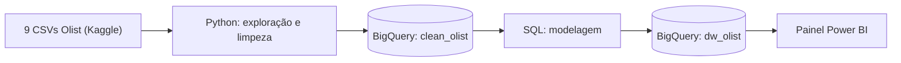
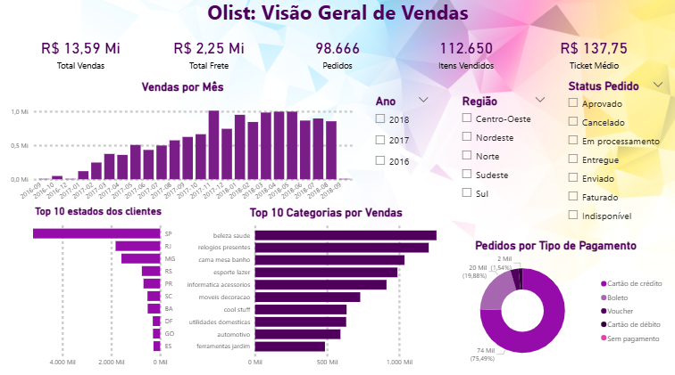

# Projeto 1: ETL e Data Warehouse no BigQuery

Primeiro capítulo da [Olist Data Platform](../README.md). Aqui os dados brutos do marketplace Olist entram na plataforma: são explorados e limpos em Python, carregados no Google BigQuery, modelados em esquema estrela com SQL e consumidos em um painel no Power BI.

## Objetivo

Transformar 9 arquivos CSV soltos em uma base confiável e pronta para análise, capaz de responder perguntas como: quanto o marketplace vendeu, quais categorias e regiões concentram as vendas e quanto das entregas chega atrasado.

## Arquitetura

| Camada | Onde | O que contém |
|---|---|---|
| Dados brutos | `Data/Raw` (fora do GitHub) | Os 9 CSVs originais |
| Dados limpos | BigQuery, dataset `clean_olist` | 8 tabelas limpas e tipadas |
| Modelo analítico | BigQuery, dataset `dw_olist` | Tabela fato, dimensões e pagamentos agregados |
| Consumo | Power BI | Painel de vendas |

## Painel

A página **Visão Geral de Vendas** reúne:

- **5 indicadores:** vendas, frete, pedidos, itens vendidos e ticket médio.
- **3 filtros:** ano, região do cliente e status do pedido.
- **4 gráficos:** vendas por mês, top 10 categorias, top 10 estados dos clientes e pedidos por tipo de pagamento.

## Principais números

Período dos pedidos: setembro de 2016 a outubro de 2018. Os totais incluem pedidos de todos os status, inclusive cancelados.

| Indicador | Valor |
|---|---|
| Vendas (itens) | R$ 13,59 milhões |
| Frete | R$ 2,25 milhões |
| Itens vendidos | 112.650 |
| Pedidos | 98.666 |
| Ticket médio | R$ 137,75 |
| Itens entregues com atraso | 6,6% |
| Tempo médio de entrega | 12,4 dias |

Alguns padrões que aparecem nos dados:

- **Pico de vendas:** novembro de 2017, com cerca de R$ 1,01 milhão no mês, coincidindo com a Black Friday.
- **Categorias:** `beleza_saude` (R$ 1,26 mi), `relogios_presentes` (R$ 1,21 mi) e `cama_mesa_banho` (R$ 1,04 mi) lideram as vendas.
- **Concentração geográfica:** SP responde por R$ 5,20 milhões em vendas, cerca de 38% do total. O Sudeste reúne 68,7% dos clientes e 73,9% dos vendedores, e só SP tem 1.849 dos 3.095 vendedores.
- **Pagamentos:** o cartão de crédito é o meio principal em 75,5% dos pedidos, seguido do boleto, com 19,9%.

## Etapas

### 1. Exploração e limpeza (Python)

Feitas no notebook `Notebooks/exploracao.ipynb` e aplicadas pelo script `SRC/01_carga_bigquery.py`. As decisões tomadas:

- **Datas:** colunas de data que vinham como texto foram convertidas para data e hora.
- **Produtos sem categoria (610):** receberam `nao_informado` e, em inglês, `not_defined`.
- **Tradução de categorias:** duas categorias não existiam no arquivo de tradução (`pc_gamer` e `portateis_cozinha_e_preparadores_de_alimentos`) e foram traduzidas manualmente, para não serem marcadas como `not_defined` por engano.
- **Medidas de produtos nulas:** mantidas como nulas, em vez de trocadas por zero, porque "não sei" é diferente de "pesa zero".
- **Geolocalização:** a tabela original tinha mais de 1 milhão de linhas, com 261.831 repetidas. Foi reduzida a uma linha por prefixo de CEP, usando a mediana das coordenadas e descartando 42 pontos fora do Brasil. Resultado: 19.010 CEPs.
- **Pagamentos:** parcelas com valor 0 foram ajustadas para 1 (pagamento à vista). Pagamentos de valor zero (9 registros) foram mantidos.

### 2. Carga no BigQuery

O script envia as 8 tabelas para o dataset `clean_olist` e, no final, compara as linhas enviadas com as linhas que chegaram ao BigQuery. A carga pode ser repetida sem duplicar dados.

### 3. Modelagem (SQL)

Os arquivos da pasta `SQL/` criam o esquema estrela no dataset `dw_olist`, na ordem numerada:

| Arquivo | Tabela | Granularidade |
|---|---|---|
| `01_dim_products.sql` | `dim_products` | um produto |
| `02_dim_customers.sql` | `dim_customers` | um `customer_id`, com região e coordenadas |
| `03_dim_sellers.sql` | `dim_sellers` | um vendedor, com região e coordenadas |
| `04_dim_date.sql` | `dim_date` | um dia (2016 a 2018) |
| `05_agg_order_payments.sql` | `agg_order_payments` | um pedido |
| `06_fact_order_items.sql` | `fact_order_items` | um item de pedido |

Decisões de modelagem:

- **Fato no nível do item.** Permite somar vendas por categoria, vendedor ou região sem perder detalhe.
- **Pagamentos agregados por pedido.** Um pedido pode ter vários pagamentos. Ligar `payments` direto aos itens repetia os valores: a soma subia de R$ 16,0 milhões para R$ 20,3 milhões. Por isso os pagamentos foram resumidos em uma linha por pedido antes de qualquer junção, e o valor pago não entra na tabela fato.
- **`customer_id` x `customer_unique_id`.** O `customer_id` muda a cada pedido, e o `customer_unique_id` identifica a pessoa (99.441 linhas para 96.096 clientes reais). A dimensão mantém os dois.
- **Regiões do Brasil** calculadas a partir do estado, para análises por região.
- **Junções que preservam linhas.** Clientes e vendedores sem CEP na tabela de geolocalização foram mantidos, com coordenadas vazias.
- **Conferências.** Cada tabela foi validada: contagem de linhas, unicidade de chaves, somas de valores e integridade entre a fato e as dimensões (nenhum item sem produto, vendedor, cliente ou data).

### 4. Painel (Power BI)

O painel importa as 6 tabelas do `dw_olist` e liga a fato às dimensões em esquema estrela. As medidas criadas são Total Vendas, Total Frete, Itens Vendidos, Pedidos, Ticket Médio, Itens Entregues, Itens Atrasados, % Atraso e Tempo Médio de Entrega. Os valores de status do pedido e de tipo de pagamento foram traduzidos para o português com colunas calculadas.

## Como reproduzir

1. Baixe o dataset *Brazilian E-Commerce Public Dataset by Olist* no Kaggle e coloque os 9 CSVs em `Data/Raw/`.
2. Crie um projeto no Google Cloud e dois datasets no BigQuery, `clean_olist` e `dw_olist`, **na mesma região**.
3. Crie uma conta de serviço, baixe a chave em JSON e salve como `credentials/gcp-key.json` (a pasta está no `.gitignore`).
4. Instale as dependências: `pip install pandas google-cloud-bigquery pyarrow db-dtypes`.
5. Ajuste o `PROJECT_ID` em `SRC/01_carga_bigquery.py` e execute `python SRC/01_carga_bigquery.py`.
6. No editor do BigQuery, rode os arquivos de `SQL/` na ordem, de `01` a `06`.
7. No Power BI, conecte ao BigQuery e importe as 6 tabelas do `dw_olist`.

## Dificuldades encontradas

- **Erro de região no Power BI.** Os datasets ficaram em `us-east1`, e a implementação nova do conector do BigQuery enviou as consultas para a região `US`, o que gerou o erro "dataset not found in location US". Foi resolvido desligando a opção da nova implementação do conector do Google BigQuery em Arquivo > Opções > Recursos de visualização.
- **Pagamentos duplicando valores.** Descoberto ao testar a junção direta com os itens, e resolvido com a tabela de pagamentos agregados por pedido.
- **BigQuery em modo Sandbox.** No modo gratuito, as tabelas expiram em cerca de 60 dias. Como a carga e a modelagem estão em scripts, tudo pode ser refeito em poucos minutos.

## Próximos passos

- Página de **entregas e atrasos** no painel (as medidas `% Atraso` e `Tempo Médio de Entrega` já existem no modelo).
- Análise de **satisfação**, incluindo as avaliações dos clientes, que têm `review_id` repetidos e exigem uma regra para escolher a avaliação de cada pedido.
- Evolução da plataforma no [projeto 2](../02-Databricks_Lakehouse), com camadas bronze, prata e ouro.

## Tecnologias

Python (pandas), Google BigQuery, SQL, Power BI, Git e GitHub.

## Fonte de dados

Brazilian E-Commerce Public Dataset by Olist, disponível no Kaggle. Os dados pertencem à Olist; consulte a licença na página do dataset.

## Autora

Feito por **Sthéfany Ferreira**.

- LinkedIn: https://www.linkedin.com/in/sthefanycaf/
- GitHub: https://github.com/SthefanyCAF
