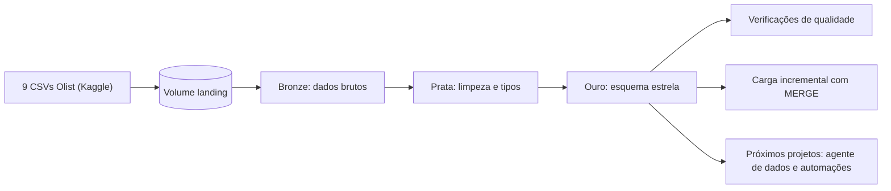
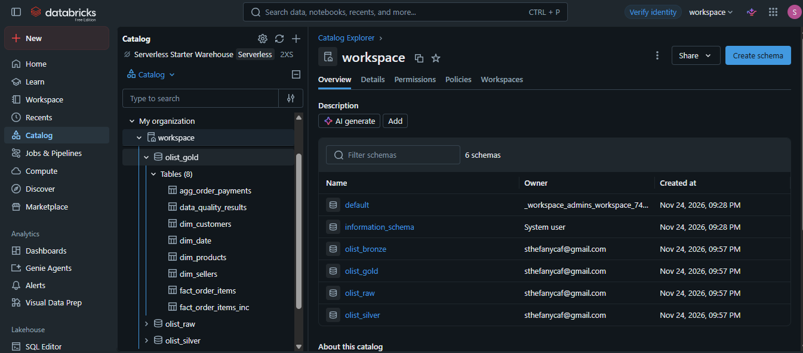
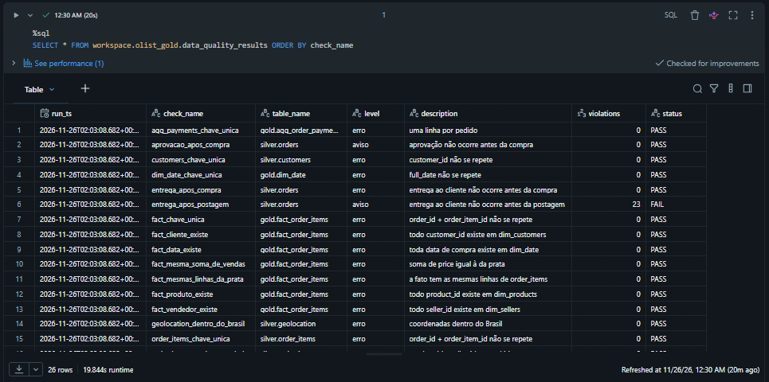
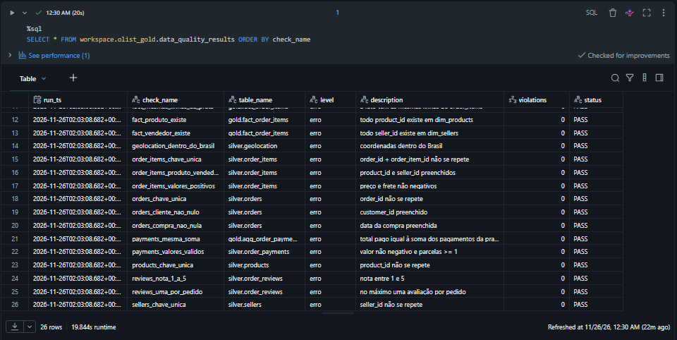

# Projeto 2: Lakehouse em camadas no Databricks

Segundo capítulo da [Olist Data Platform](../README.md). No [projeto 1](../01-BigQuery_ETL_DW), os dados do marketplace Olist viraram um Data Warehouse no BigQuery. Aqui, os mesmos dados são reconstruídos como um **lakehouse** no Databricks, com camadas bronze, prata e ouro, testes automáticos de qualidade e carga incremental.

## Objetivo

Construir um pipeline em camadas, confiável e reproduzível, que parte dos 9 CSVs brutos e entrega tabelas prontas para análise, e provar que o resultado é consistente com o Data Warehouse do projeto 1.

## Arquitetura

| Camada | Schema | O que contém |
|---|---|---|
| Arquivos brutos | `olist_raw` (volume `landing`) | Os 9 CSVs originais |
| Bronze | `olist_bronze` | 9 tabelas Delta, cópia fiel da origem, mais colunas de controle (`_ingestion_ts` e `_source_file`) |
| Prata | `olist_silver` | 8 tabelas limpas e tipadas |
| Ouro | `olist_gold` | Esquema estrela, resultados dos testes e tabela incremental |

Todas as tabelas ficam no catálogo `workspace`.

## Notebooks

| Notebook | O que faz |
|---|---|
| `00_setup` | Cria os schemas e o volume |
| `01_bronze` | Lê os 9 CSVs e grava como tabelas Delta, sem alterar os dados |
| `02_silver` | Aplica limpeza, tipos e regras de negócio |
| `03_gold` | Monta as dimensões, os pagamentos agregados e a tabela fato |
| `04_quality` | Roda 26 verificações de qualidade e a carga incremental |

## Decisões de projeto

### Bronze

- **Dados como chegaram.** Nenhuma limpeza, só a leitura e a gravação em tabela. Isso preserva a origem para auditoria.
- **Leitura robusta do CSV de avaliações.** Os comentários têm quebra de linha e aspas, e por isso a leitura usa `multiLine`, `quote` e `escape`. Sem isso, as linhas seriam divididas no lugar errado.
- **Rastreabilidade.** Cada linha guarda a data e hora da carga e o arquivo de origem.

### Prata

As decisões do projeto 1 foram refeitas em PySpark, com um ajuste:

- Datas viram `timestamp`, e valores viram `int` ou `double`.
- Parcelas com valor 0 viram 1 (pagamento à vista).
- Produtos sem categoria recebem `nao_informado`, e as categorias são traduzidas para o inglês. Duas categorias que não existem no arquivo de tradução (`pc_gamer` e `portateis_cozinha_e_preparadores_de_alimentos`) foram traduzidas manualmente.
- Medidas de produtos nulas continuam nulas, porque "não sei" é diferente de "pesa zero".
- Geolocalização: uma linha por CEP, descartando pontos fora do Brasil e usando a **mediana** das coordenadas.
- **Novo em relação ao projeto 1:** os pedidos com mais de uma avaliação ficam com a **mais recente**, o que resolve os `review_id` repetidos e deixa uma avaliação por pedido (98.673 linhas).

### Ouro

- Mesmo esquema estrela do projeto 1: `fact_order_items` (uma linha por item), `dim_products`, `dim_customers`, `dim_sellers`, `dim_date` e `agg_order_payments`.
- **Pagamentos agregados por pedido** antes de qualquer junção, para o valor pago não ser contado em duplicidade.
- **Novo em relação ao projeto 1:** a fato recebe `review_score`, o que permite analisar satisfação.

### Qualidade

O notebook `04_quality` roda 26 verificações que contam as linhas que violam uma regra:

- chaves únicas
- campos obrigatórios
- valores válidos (nota de 1 a 5, preços não negativos, coordenadas dentro do Brasil)
- coerência de datas
- integridade entre a fato e as dimensões
- reconciliação entre camadas (mesmas linhas e mesma soma de vendas entre prata e ouro)

Cada execução é acrescentada à tabela `olist_gold.data_quality_results`, o que forma um histórico. Os testes têm dois níveis: `erro` interrompe o pipeline e `aviso` só informa.

### Carga incremental

Para simular a chegada de dados novos, a tabela `fact_order_items_inc` começa com os pedidos até 31/07/2018 (105.401 linhas), e os pedidos de 01/08/2018 em diante (7.249 linhas) chegam como um lote novo. O `MERGE` insere o que é novo e atualiza o que já existe, usando `order_id` + `order_item_id` como chave. Rodar o mesmo lote de novo não duplica nada, o que torna a carga **idempotente**.

## Resultados

### Consistência com o projeto 1

Os números do lakehouse batem com os do Data Warehouse no BigQuery:

| Indicador | BigQuery (projeto 1) | Databricks (projeto 2) |
|---|---|---|
| Linhas da tabela fato | 112.650 | 112.650 |
| Soma de vendas (price) | R$ 13.591.643,70 | R$ 13.591.643,70 |
| Soma de frete | R$ 2.251.909,54 | R$ 2.251.909,54 |
| Itens entregues com atraso | 6,6% | 6,6% |
| Tempo médio de entrega | 12,4 dias | 12,4 dias |
| Total pago (pagamentos agregados) | R$ 16.008.872,12 | R$ 16.008.872,12 |

### Qualidade

Das 26 verificações, **25 passaram** e **1 gerou aviso**: 23 pedidos têm data de entrega ao cliente anterior à data de postagem. É uma inconsistência da própria origem, e por isso ficou como aviso e não como erro.

### Satisfação dos clientes

Com a avaliação na tabela fato, aparece algo que o projeto 1 não mostrava:

- A nota média geral é **4,03**.
- Entre os itens entregues, a nota média é **4,21 quando a entrega chega no prazo** e **2,26 quando atrasa**.

## Projeto 1 x projeto 2

| | Projeto 1 | Projeto 2 |
|---|---|---|
| Plataforma | BigQuery (Data Warehouse) | Databricks (lakehouse) |
| Linguagem principal | Python (pandas) e SQL | PySpark e Spark SQL |
| Organização | Datasets `clean_olist` e `dw_olist` | Camadas bronze, prata e ouro |
| Formato das tabelas | BigQuery | Delta |
| Avaliações | Fora do modelo | Uma por pedido, dentro da fato |
| Qualidade | Conferências manuais | 26 testes automáticos com histórico |
| Carga | Recarga completa | Incremental com `MERGE` |

## Como reproduzir

1. Baixe o dataset *Brazilian E-Commerce Public Dataset by Olist* no Kaggle.
2. Em um workspace Databricks, importe os notebooks da pasta `Notebooks` e rode o `00_setup` para criar os schemas e o volume.
3. Envie os 9 CSVs para o volume `workspace.olist_raw.landing`.
4. Rode os notebooks na ordem: `01_bronze`, `02_silver`, `03_gold` e `04_quality`.
5. Confira as contagens impressas em cada notebook e o resultado em `olist_gold.data_quality_results`.

## Próximos passos

- [Projeto 3](../03-Databricks_AI_Agent): um agente de dados que responde perguntas de negócio consultando as tabelas ouro.
- [Projeto 5](../05-N8N_Automation): automações que usam as tabelas ouro e os resultados dos testes de qualidade para enviar resumos e alertas.

## Tecnologias

Databricks, PySpark, Spark SQL, Delta Lake, Unity Catalog (volumes), Git e GitHub.

## Fonte de dados

Brazilian E-Commerce Public Dataset by Olist, disponível no Kaggle. Os dados pertencem à Olist; consulte a licença na página do dataset.

## Autora

Feito por **Sthéfany Ferreira**.

- LinkedIn: https://www.linkedin.com/in/sthefanycaf/
- GitHub: https://github.com/SthefanyCAF
