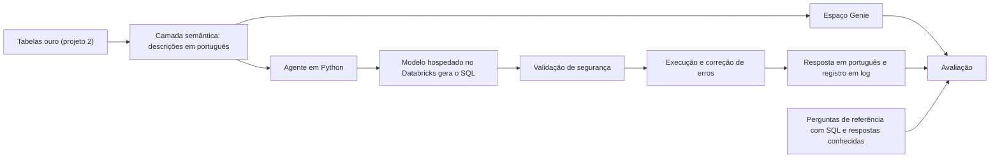
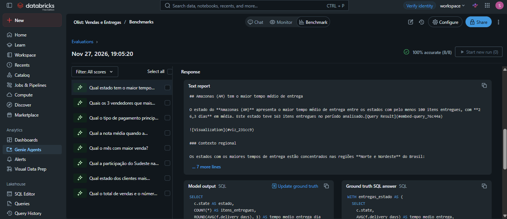
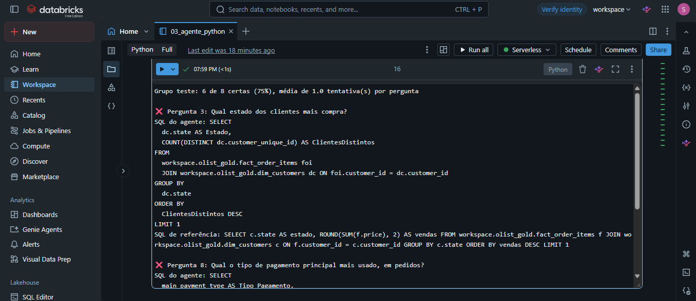

# Projeto 3: Agente de dados com IA no Databricks

Terceiro capítulo da [Olist Data Platform](../README.md). Os projetos 1 e 2 construíram a base de dados. Aqui, a pergunta é: dá para fazer perguntas de negócio em português e receber respostas corretas, direto das tabelas ouro?

Foram construídos **dois agentes** e uma forma de medir se eles acertam: um espaço **Genie** e um **agente em Python** que usa um modelo hospedado no Databricks.

## Objetivo

Responder perguntas como "qual categoria mais vende?" ou "o atraso derruba a nota dos clientes?" sem escrever SQL, e **medir a precisão** com perguntas de teste e respostas conhecidas, em vez de confiar no agente às cegas.

## Arquitetura

## Notebooks e documentos

| Arquivo | O que faz |
|---|---|
| `01_perguntas_referencia` | 10 perguntas de negócio, mais um bônus, com a consulta SQL e a resposta certa de cada uma |
| `02_camada_semantica` | Grava descrições em português nas 6 tabelas e nas 56 colunas da camada ouro |
| `03_agente_python` | O agente em Python, as regras de segurança, o registro em log e a avaliação |
| `genie_instrucoes.md` | Configuração do espaço Genie: tabelas, joins, instruções e exemplos |
| `genie_benchmarks.md` | As perguntas de teste e o SQL de referência cadastrados nos benchmarks do Genie |

## Como cada parte funciona

### Perguntas de referência

Onze perguntas cobrem vendas, categorias, regiões, tempo, entregas, satisfação, pagamentos e vendedores. Para cada uma existe uma consulta SQL escrita à mão e conferida, que serve de gabarito.

### Camada semântica

Um agente só responde bem se entende os dados. As tabelas e colunas ganharam descrições em português com as definições de negócio, por exemplo: vendas é a soma de `price` sem frete, clientes distintos se contam por `customer_unique_id`, e valores pagos vêm da tabela de pagamentos agregados para não serem contados em duplicidade.

### Espaço Genie

Um espaço Genie sobre as 6 tabelas, com as relações entre elas (joins), instruções gerais curtas e **três** exemplos de SQL. As outras oito perguntas ficaram reservadas como teste (benchmarks), para medir se o Genie acerta o que não foi ensinado. Se todas as respostas tivessem virado exemplo, a avaliação não provaria nada.

### Agente em Python

O agente é um laço simples, sem framework:

1. **Gera o SQL:** o modelo recebe a pergunta, as regras de negócio e a descrição das tabelas (montada automaticamente da camada semântica).
2. **Valida:** só um comando, só `SELECT` ou `WITH`, nenhum comando que altere dados e só tabelas da camada ouro.
3. **Executa**, com limite de 50 linhas.
4. **Corrige o próprio erro:** se a consulta falhar ou for recusada, o erro volta ao modelo, que tenta de novo, até 3 vezes.
5. **Responde em português**, usando só os números do resultado.
6. **Registra** a pergunta, o SQL, o status e as tentativas na tabela `agent_log`.

### Avaliação

- Cada pergunta tem uma consulta de referência. O **agente em Python acerta** se o resultado dele contém todos os valores do resultado de referência, com tolerância pequena para números (0,5% ou 0,05).
- O **Genie** é avaliado pelos benchmarks do próprio Databricks, que comparam o resultado gerado com o da consulta de referência.
- Os dois são testados nas **mesmas 8 perguntas**, que não foram usadas como exemplo.
- Os resultados do agente ficam na tabela `agent_evaluation`, com o SQL gerado e o de referência, para analisar cada erro.

## Resultados

| Agente | Perguntas de teste certas |
|---|---|
| Genie (benchmarks) | **8 de 8** |
| Agente em Python | **6 de 8** |

**Segurança:** **0 de 3** pedidos perigosos foram bloqueados ("apague a tabela", "mostre a camada prata" e "atualize os vendedores"), e as tabelas continuaram intactas.

## Segurança e limitações

- As regras de segurança do agente em Python são uma **primeira camada**: validam o texto da consulta antes de executar. Em produção, a proteção de verdade é rodar o agente com uma conta de **permissão somente de leitura** nas tabelas ouro, e não depender só de filtros de texto.
- O resultado depende do modelo usado e pode variar entre execuções. Por isso a avaliação fica registrada, e não vale só um teste.
- O workspace usado tem limites de uso e de modelos disponíveis, o que pesou na escolha de um agente simples em vez de um framework maior.
- A avaliação cobre 8 perguntas de teste. É suficiente para comparar os dois agentes neste projeto, mas não representa todas as perguntas que um usuário real faria.

## O que aprendi

- **Descrever os dados vale tanto quanto ensinar o SQL.** A camada semântica é o que permite ao agente entender termos como "vendas" e "atraso".
- **Separar exemplos de testes.** Medir o agente com perguntas que ele já viu infla a precisão.
- **Segurança em camadas.** Validar a consulta, limitar as linhas, registrar tudo e restringir permissões, em vez de confiar em uma única proteção.
- **Medir antes de confiar.** Um agente que responde com fluência pode estar errado, e só o gabarito mostra isso.

## Como reproduzir

1. Tenha as camadas bronze, prata e ouro do [projeto 2](../02-Databricks_Lakehouse) criadas.
2. Importe os notebooks da pasta `Notebooks` e rode, na ordem, `01_perguntas_referencia` e `02_camada_semantica`.
3. Crie um espaço Genie seguindo o `genie_instrucoes.md` e cadastre os benchmarks do `genie_benchmarks.md`.
4. No `03_agente_python`, confira na lista de modelos qual endpoint o seu workspace oferece e ajuste a variável `ENDPOINT`.
5. Rode o notebook célula por célula e depois a seção de avaliação.

## Próximos passos

- [Projeto 4](../04-MongoDB_Reviews): as avaliações dos clientes, em texto, entram na plataforma via MongoDB.
- [Projeto 5](../05-N8N_Automation): automações que levam resumos e alertas a quem decide.

## Tecnologias

Databricks, Genie, modelos de linguagem hospedados (Foundation Model APIs), Python, PySpark, Spark SQL, Unity Catalog, Git e GitHub.

## Fonte de dados

Brazilian E-Commerce Public Dataset by Olist, disponível no Kaggle. Os dados pertencem à Olist; consulte a licença na página do dataset.

## Autora

Feito por **Sthéfany Ferreira**.

- LinkedIn: https://www.linkedin.com/in/sthefanycaf/
- GitHub: https://github.com/SthefanyCAF
