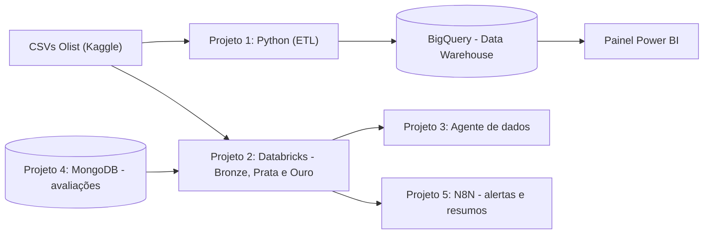

# Olist Data Platform

Plataforma de dados de e-commerce construída do zero, do dado bruto até uma pergunta respondida por inteligência artificial.
Cada projeto deste repositório é um capítulo da mesma história e aproveita o que o anterior construiu.

## Sobre o projeto

Um marketplace gera dados espalhados em várias tabelas: pedidos, itens, pagamentos, clientes, vendedores, produtos e avaliações. Sozinhas, essas tabelas não respondem às perguntas do negócio. É preciso ingerir, limpar, organizar e disponibilizar os dados de forma confiável.

Este repositório documenta a construção dessa base em etapas. Começa com um Data Warehouse na nuvem, evolui para um Lakehouse em camadas e termina com um agente que responde perguntas em linguagem natural e com automações que levam a informação a quem decide.

### Perguntas de negócio que a plataforma busca responder

- Quais categorias de produto mais vendem e mais faturam?
- Onde estão os atrasos de entrega e quais regiões são mais afetadas?
- Como o atraso na entrega se relaciona com a nota das avaliações?
- Qual é o ticket médio e como ele varia por região e forma de pagamento?
- Quais vendedores concentram mais pedidos e mais problemas?

## Arquitetura



## Projetos

| # | Projeto | Papel na história | O que entrega | Tecnologias | Status |
|---|---------|-------------------|---------------|-------------|--------|
| 1 | [ETL e Data Warehouse](./01-BigQuery_ETL_DW) | Os dados entram | Dados limpos no BigQuery, modelo em fatos e dimensões e painel de vendas e entregas | Python, pandas, BigQuery, SQL, Power BI | 🟡 Em andamento |
| 2 | [Lakehouse em camadas](./02-Databricks_Lakehouse) | Os dados ganham qualidade | Pipeline bronze, prata e ouro com carga incremental e verificações de qualidade | Databricks, PySpark, SQL | ⚪ A fazer |
| 3 | [Agente de dados](./03-Databricks_AI_Agent) | Os dados respondem perguntas | Agente que responde perguntas de negócio consultando as tabelas ouro | Databricks, IA agêntica | ⚪ A fazer |
| 4 | [Avaliações no MongoDB](./04-MongoDB_Reviews) | Dados semiestruturados entram na plataforma | Avaliações dos clientes em banco NoSQL, integradas à camada prata | MongoDB, Python | ⚪ A fazer |
| 5 | [Automação com N8N](./05-N8N_Automation) | A informação chega a quem decide | Fluxo automatizado com resumos e alertas, por exemplo pedidos atrasados | N8N | ⚪ A fazer |

## Fonte de dados

Brazilian E-Commerce Public Dataset by Olist, disponibilizado publicamente no Kaggle. Reúne pedidos feitos em um marketplace brasileiro, divididos em 9 arquivos:

| Arquivo | Conteúdo |
|---------|----------|
| `olist_orders_dataset` | Pedidos, status e datas |
| `olist_order_items_dataset` | Itens de cada pedido, preço, frete e vendedor |
| `olist_order_payments_dataset` | Formas e valores de pagamento |
| `olist_order_reviews_dataset` | Avaliações, com nota e comentário |
| `olist_customers_dataset` | Clientes e localização |
| `olist_sellers_dataset` | Vendedores e localização |
| `olist_products_dataset` | Produtos, categoria e dimensões |
| `olist_geolocation_dataset` | Prefixos de CEP com latitude e longitude |
| `product_category_name_translation` | Tradução dos nomes de categoria |

Os dados pertencem à Olist. Consulte a licença na página do dataset no Kaggle. Os arquivos não estão neste repositório por causa do tamanho.

## Estrutura do repositório

```
Olist_Data_Platform/
├── 01-BigQuery_ETL_DW/
│   ├── Dashboard/    # arquivo e prints do painel
│   ├── Data/         # dados brutos, fora do GitHub
│   ├── Notebooks/    # exploração dos dados
│   ├── SQL/          # modelagem no BigQuery
│   └── SRC/          # scripts de extração, limpeza e carga
├── 02-Databricks_Lakehouse/
├── 03-Databricks_AI_Agent/
├── 04-MongoDB_Reviews/
├── 05-N8N_Automation/
├── Docs/             # diagramas e imagens usados nos READMEs
└── README.md
```

## Decisões de projeto

- **Uma história só.** Em vez de projetos soltos, todos usam o mesmo dataset e evoluem a mesma plataforma.
- **Limpeza antes da carga.** No projeto 1, os dados são limpos e formatados em Python antes de entrar no BigQuery. A modelagem de negócio acontece depois, em SQL.
- **Qualidade em camadas no projeto 2.** A limpeza mais profunda e as verificações de qualidade ficam nas camadas bronze, prata e ouro.
- **Dados fora do repositório.** Os CSVs ficam apenas no computador, protegidos pelo `.gitignore`.
- **Credenciais fora do repositório.** Chaves de acesso à nuvem nunca são versionadas.

## Como reproduzir

1. Clone o repositório:
   ```
   git clone https://github.com/SthefanyCAF/Olist_Data_Platform.git
   ```
2. Baixe o dataset no Kaggle e coloque os 9 arquivos CSV em `01-BigQuery_ETL_DW/Data/Raw/`.
3. Crie uma conta no Google Cloud, um projeto e um dataset no BigQuery. Salve a chave de acesso em uma pasta `credentials/`, que o `.gitignore` já ignora.
4. Crie um ambiente virtual Python e instale as dependências indicadas no README de cada projeto.
5. Siga o README da pasta de cada projeto para executar as etapas na ordem.

## Autora

Feito por **Sthéfany Ferreira**, em transição para Engenharia de Dados.

- LinkedIn: https://www.linkedin.com/in/sthefanycaf/
- GitHub: https://github.com/SthefanyCAF